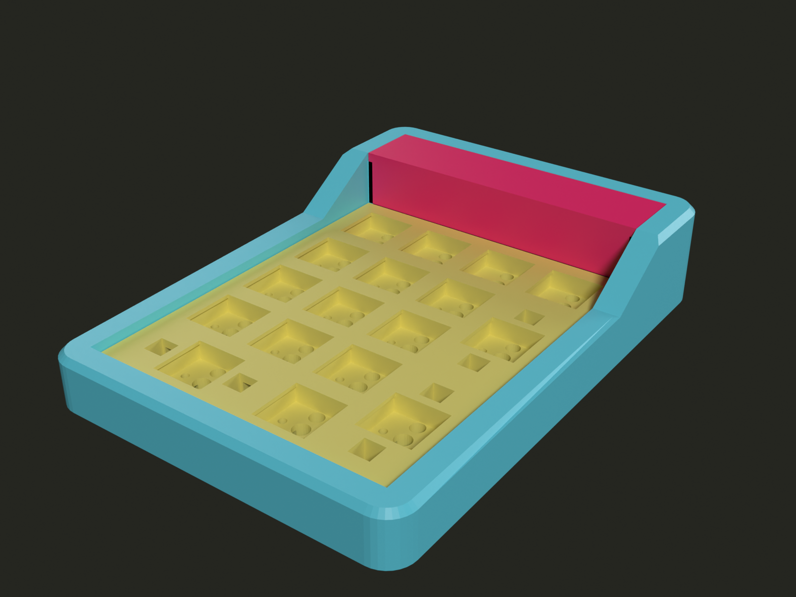
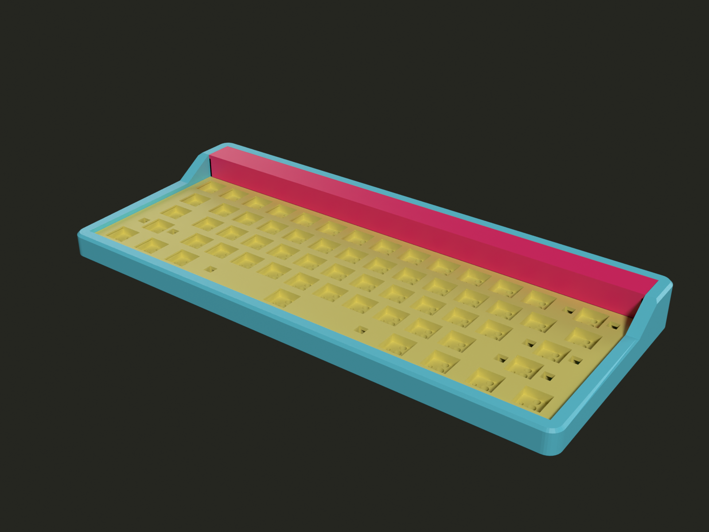
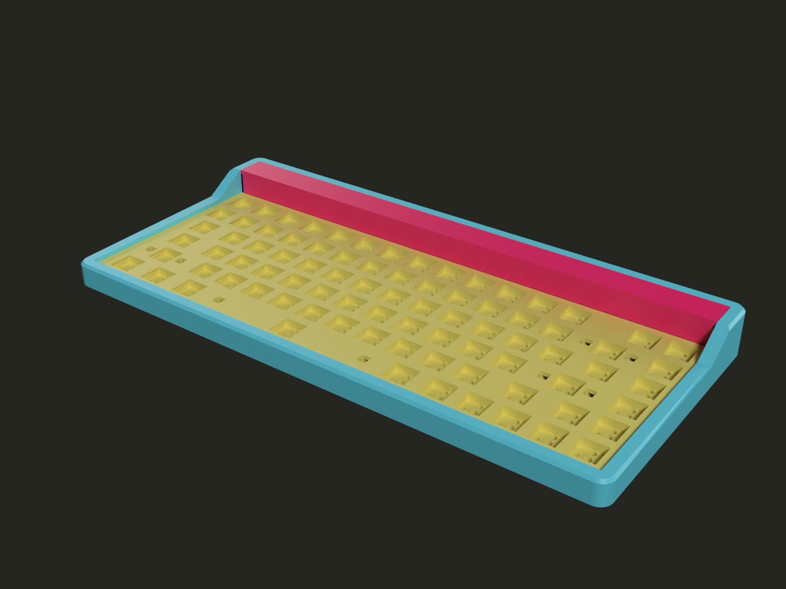
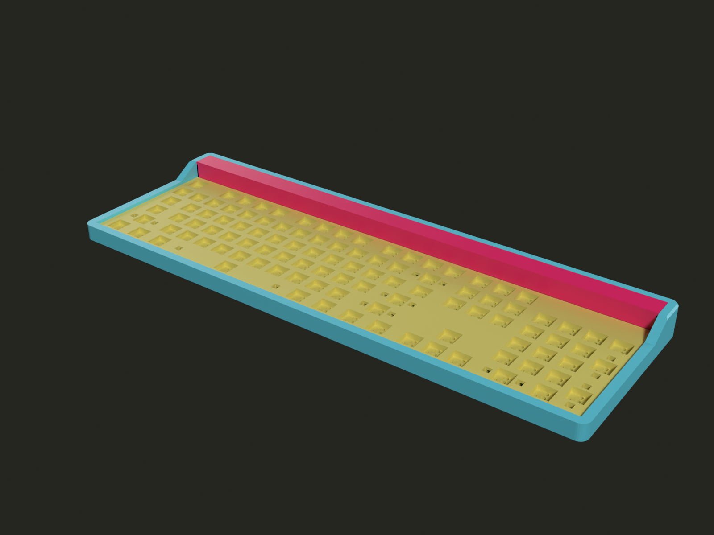

# Screenshots and generation commands

These renders use the current defaults:

- 2 mm plate padding on all sides
- 7 mm case walls
- 17.5 mm-deep electronics bay
- 27.5 mm-tall compartment
- north-facing switches/LEDs
- Monokai colors: cyan case, pink cover, yellow top plate

Each section lists the command that generates the STLs and the command that
renders the preview image. Run all commands from the repository root.

The images shown on this page live in `screenshots/`. The render commands write
to `build/`; copy the four PNGs afterwards:

```powershell
New-Item -ItemType Directory -Force screenshots
Copy-Item build\kbNumpad_preview.png, build\kb60_preview.png, build\kb75_preview.png, build\kb100_preview.png screenshots\
```

## Generate all four keyboards

```sh
blender --background --python-exit-code 1 --python keyboards/kbNumpad/main.py
blender --background --python-exit-code 1 --python keyboards/kb60/main.py
blender --background --python-exit-code 1 --python keyboards/kb75/main.py
blender --background --python-exit-code 1 --python keyboards/kb100/main.py
```

The preview renderer is separate from STL generation:

```sh
blender --background --python-exit-code 1 --python keyboards/render_preview.py -- --keyboard kbNumpad
blender --background --python-exit-code 1 --python keyboards/render_preview.py -- --keyboard kb60
blender --background --python-exit-code 1 --python keyboards/render_preview.py -- --keyboard kb75
blender --background --python-exit-code 1 --python keyboards/render_preview.py -- --keyboard kb100
```

## Numpad — 17 keys



Generate:

```sh
blender --background --python-exit-code 1 --python keyboards/kbNumpad/main.py
```

Render:

```sh
blender --background --python-exit-code 1 --python keyboards/render_preview.py -- --keyboard kbNumpad
```

Outputs:

```text
build/kbNumpad/top_plate/top_plate.stl
build/kbNumpad/case/case_bottom.stl
build/kbNumpad/case/case_edges.stl
build/kbNumpad/cover/cover.stl
build/kbNumpad_preview.png
```

Plate 87.4 × 102.85 × 9.5 mm · case bottom 89.2 × 125.75 × 6.8 mm ·
case edges 94.7 × 131.25 × 27.5 mm · cover 80.3 × 17.3 × 15.0 mm.

## 60% — ANSI 61 keys



Generate:

```sh
blender --background --python-exit-code 1 --python keyboards/kb60/main.py
```

Render:

```sh
blender --background --python-exit-code 1 --python keyboards/render_preview.py -- --keyboard kb60
```

Outputs:

```text
build/kb60/top_plate/top_plate.stl
build/kb60/case/case_bottom.stl
build/kb60/case/case_edges_west.stl
build/kb60/case/case_edges_east.stl
build/kb60/case/case_edges_north.stl
build/kb60/case/case_edges_south.stl
build/kb60/cover/cover.stl
build/kb60_preview.png
```

Plate 296.95 × 102.85 × 9.5 mm · case bottom 298.75 × 125.75 × 6.8 mm ·
case edges 304.25 × 131.25 × 27.5 mm · cover 289.85 × 17.3 × 15.0 mm.

## 75% — 83 keys



Generate:

```sh
blender --background --python-exit-code 1 --python keyboards/kb75/main.py
```

Render:

```sh
blender --background --python-exit-code 1 --python keyboards/render_preview.py -- --keyboard kb75
```

Outputs:

```text
build/kb75/top_plate/top_plate.stl
build/kb75/case/case_bottom.stl
build/kb75/case/case_edges_west.stl
build/kb75/case/case_edges_east.stl
build/kb75/case/case_edges_north.stl
build/kb75/case/case_edges_south.stl
build/kb75/cover/cover.stl
build/kb75_preview.png
```

Plate 316.0 × 121.9 × 9.5 mm · case bottom 317.8 × 144.8 × 6.8 mm ·
case edges 323.3 × 150.3 × 27.5 mm · cover 308.9 × 17.3 × 15.0 mm.

## 100% — ANSI 104 keys



Generate:

```sh
blender --background --python-exit-code 1 --python keyboards/kb100/main.py
```

Render:

```sh
blender --background --python-exit-code 1 --python keyboards/render_preview.py -- --keyboard kb100
```

Outputs:

```text
build/kb100/top_plate/top_plate.stl
build/kb100/case/case_bottom.stl
build/kb100/case/case_edges_west.stl
build/kb100/case/case_edges_east.stl
build/kb100/case/case_edges_north.stl
build/kb100/case/case_edges_south.stl
build/kb100/cover/cover.stl
build/kb100_preview.png
```

Plate 439.83 × 121.9 × 9.5 mm · case bottom 441.62 × 144.8 × 6.8 mm ·
case edges 447.12 × 150.3 × 27.5 mm · cover 432.73 × 17.3 × 15.0 mm.

## Stabilizer slider

The keyboard previews do not show the stabilizer sliders. Generate the slider
separately:

```sh
blender --background --python-exit-code 1 --python keyboards/stabilizers/main.py
```

Output:

```text
build/stabilizer_slider.stl
```

Print two per stabilized key. The script also prints the wire cut lengths for
2u, 2.25u, 2.75u, 3u, 6u, 6.25u and 7u.

## Custom variants

Use `--output` to avoid overwriting the defaults. For example, a south-facing
60%:

```sh
blender --background --python-exit-code 1 --python keyboards/kb60/main.py -- \
  --led-facing south --output build/kb60_south.stl
```

This writes:

```text
build/kb60_south.stl
build/kb60_south_case_bottom.stl
build/kb60_south_case_edges.stl
build/kb60_south_cover.stl
```

`--output` is a flat override. Without it, each keyboard writes its own
`build/<name>/top_plate/`, `build/<name>/case/` and `build/<name>/cover/`
tree.

Screenshots in `screenshots/` are documentation copies; the render commands
write to `build/`. STLs and the working previews in `build/` are generated
artifacts.
